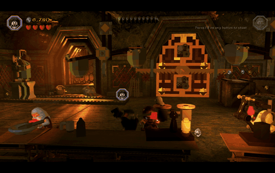
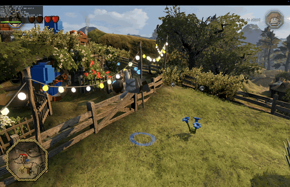

> [!IMPORTANT]
> This project does not include any game files. You need your own Steam copy of LEGO The Hobbit for Mac.

<h1 align="center">
  
  <br>
  Hobbit Recompiled
</h1>

<p align="center">
  
  
  
</p>

<p align="center"><i>34-second video: <a href="docs/media/gameplay.mp4">gameplay.mp4</a></i></p>

The Mac version of LEGO The Hobbit (Feral Interactive, 2014) is a 32-bit Intel app, so it stopped working when macOS dropped 32-bit support. This project translates the game's code to C ahead of time and compiles it into a native arm64 app for Apple Silicon. You still need Rosetta 2 installed, but only for a small helper that compiles the game's shaders.

This project is not affiliated with or endorsed by TT Games, Warner Bros. Games, Feral Interactive or the LEGO Group.

## Contents

- [Requirements](#requirements)
- [Install](#install)
- [Playing](#playing)
- [Saves](#saves)
- [Status](#status)
- [Performance](#performance)
- [Troubleshooting](#troubleshooting)
- [Building and development](#building-and-development)
- [Credits](#credits)
- [Support](#support)
- [License](#license)

## Requirements

- A Mac with Apple Silicon (M1 or newer)
- LEGO The Hobbit for Mac from Steam, build 84019 (Steam app 285160)
- Xcode Command Line Tools
- Homebrew with SDL2 (needed to build; the app carries its own copy of SDL)
- Python 3.11 or newer
- Rosetta 2
- About 2 GB of free disk space

## Install

1. Install the game from Steam and let it finish updating.
2. Install the Xcode Command Line Tools, and wait until the installer says it is done:
   ```sh
   xcode-select --install
   ```
3. Install [Homebrew](https://brew.sh) if you do not have it, then the other tools:
   ```sh
   /bin/bash -c "$(curl -fsSL https://raw.githubusercontent.com/Homebrew/install/HEAD/install.sh)"
   brew install sdl2 python
   softwareupdate --install-rosetta --agree-to-license
   ```
4. Get the code and run the setup script:
   ```sh
   git clone --recurse-submodules https://github.com/itsdunintime104/HobbitRecompiled.git
   cd HobbitRecompiled
   ./setup.sh
   ```
5. Open **Hobbit Recompiled** from `~/Applications`.

`setup.sh` checks your Mac, copies the game binary from your Steam folder, translates it (about 3 minutes), builds the app and installs it. It never changes the Steam folder. If something is missing, it tells you what and how to fix it. `./setup.sh --check` runs only that check.

If the game is in another Steam library, run `HOBBIT_APP="/path/to/LEGO The Hobbit.app" ./setup.sh`. The app remembers that path.

| Option | Effect |
|---|---|
| `--check` | Only check the requirements |
| `--force` | Translate again. Use it after `git pull` |
| `--no-install` | Build the app in `build.nosync/` without copying it to `~/Applications` |

## Playing

Controllers that SDL2 supports work, including Xbox and DualShock 4 pads. Connect the controller before you start the game.

| Key | Action |
|---|---|
| Cmd+Q | Quit |
| Cmd+F | Show or hide the performance overlay ([what it shows](docs/BUILDING.md#the-overlay)) |

The game renders at your display's scaled size. To change it, use the resolution setting in the game's Options. It offers the full panel size, 75%, the desktop size and 50%.

Each run writes a log to `~/Library/Logs/HobbitRecomp/`. It holds startup messages, warnings and errors. It does not record what you do in the game. If the game stops, the last lines of the log say why. Attach the log when you report a problem. The log stays on your Mac, and the app keeps the newest 20.

## Saves

The game saves through Steam Cloud. Hobbit Recompiled keeps those files in `~/Library/Application Support/HobbitRecomp/remote` instead. On the first run it copies your existing Steam Cloud saves there. After that it never writes to the Steam folder, so new saves do not sync to Steam Cloud.

> [!WARNING]
> Back up `~/Library/Application Support/HobbitRecomp/remote` before you play.

## Status

The intro, menus, saves and level 1 work. Level 1 has been played to the end, and a 55-minute session ran without a crash.

- Controllers show Xbox button icons, also for a DualShock 4. The Mac version of the game does this for every controller.
- Achievements and stats are offline.
- Apple's Metal Performance HUD does not appear, because the game draws with OpenGL. Use the overlay (Cmd+F) instead.

## Performance

Tested on a MacBook Pro 16-inch (2021) with an M1 Max (10-core CPU, 32-core GPU, 32 GB) and macOS 26.6.2. The game draws with OpenGL 2.1 on Apple's Metal-based driver.

| Scene | Resolution | Frame rate | Frame time |
|---|---|---|---|
| Hobbiton, played by hand | 2056 × 1329 | 110-120 FPS | 8.3-9.1 ms median, 99% under 10.2 ms |
| Hobbiton, scripted walking, jumping and actions | 2056 × 1329 | 120-126 FPS | 7.9-8.3 ms median, 99% under 11 ms |
| Hobbiton, while screen recording | 3456 × 2169 | 84 FPS, 1% low 66 FPS | 11.9 ms average, 99% under 15.1 ms |



*Hobbiton at 3456 × 2169 with the overlay. Full clip: [hobbiton.mp4](docs/media/hobbiton.mp4)*

To record every frame time, start the app with the flag `HOBBITRECOMP_FRAMELOG=1`. It then writes `~/Library/Logs/HobbitRecomp/frames-<date>_<time>.csv`:

```sh
open --env HOBBITRECOMP_FRAMELOG=1 "$HOME/Applications/Hobbit Recompiled.app"
```

To turn a CSV into a chart:

```sh
(cd engine && ../.venv/bin/python -m tools.perf.plot_frames ~/Library/Logs/HobbitRecomp/frames-<date>_<time>.csv)
```

## Troubleshooting

| Problem | Fix |
|---|---|
| Black window that never starts | Click the game window. macOS gave keyboard focus to another app |
| "game binary not found" or "LEGO The Hobbit was not found" | Install the game from Steam, or set `HOBBIT_APP` as shown in [Install](#install) |
| `setup.sh` says the sha256 does not match | Only build 84019 works. Let Steam finish updating, and leave any beta branch |
| Black screen after the intro, or shaders fail | Install Rosetta 2: `softwareupdate --install-rosetta --agree-to-license` |
| macOS says the app is damaged | Build the app with `setup.sh` on your own Mac. A copy from another Mac does not run |

## Building and development

[docs/BUILDING.md](docs/BUILDING.md) covers how the translation works, building by hand, debug options, tests and the repository layout.

## Credits

- **[xboxrecomp](https://github.com/sp00nznet/xboxrecomp)** by sp00nznet: the x86-to-C translator this project's translator is forked from (MIT license).
- **[saga](https://github.com/opensagadev/saga)**: a decompilation of LEGO Star Wars: The Complete Saga, which uses the same engine. Used only as a reference; no code was copied from it.
- **[SDL2](https://www.libsdl.org/)**: window, input and controllers (zlib license).
- **dlmalloc** by Doug Lea: the guest heap allocator (MIT-0).

## Support

[](https://buymeacoffee.com/itdunintime)

| Currency | Address |
|:---------|:--------|
| BTC | `1A7DmUpKRkuoSTKkWDcFR6SBdtpGqa1R8x` |
| ETH | `0x772a320ff05c763eae76868b971b6d53daee36e7` |
| SOL | `En858GF2YnTtTo4rmGfdTADof5gdVMGv1d13favtAbS5` |
| USDT (ERC-20) | `0x772a320ff05c763eae76868b971b6d53daee36e7` |

## License

GPL-3.0. See [LICENSE](LICENSE). Third-party code keeps its own license: see `engine/tools/xrecomp/LICENSE`, `engine/tools/xrecomp/NOTICE` and the header of `engine/runtime/src/dlmalloc.c`.

The repository contains no game assets, no game binary and no code generated from the game. `recon/` holds function addresses, import names, switch tables and recovered names taken from the game binary, which the translator needs.
